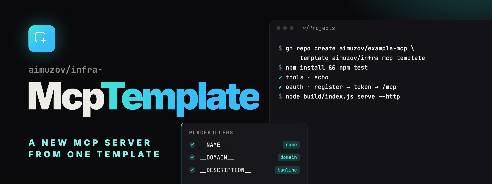

<p align="center">
	
	<a href="README.ru.md"></a>
</p>

<p align="center">
	
</p>

<p align="center">
	<a href="https://github.com/aimuzov/infra-mcp-template/actions/workflows/check.yml"></a>
	<a href="https://github.com/aimuzov/infra-mcp-template/releases"></a>
	<a href="package.json"></a>
	<a href="https://modelcontextprotocol.io"></a>
	<a href="LICENSE"></a>
</p>

<h3 align="center">A new MCP server from one template</h3>
<p align="center">stdio server, hosted OAuth connector with pages, checks, release and deploy</p>

Starting point of an aimuzov MCP server on [infra-mcp-kit](https://github.com/aimuzov/infra-mcp-kit): a stdio server with one example tool, a hosted connector with OAuth and pages in the "Signal" style, checks, release and deploy. The examples below create `example-mcp`.

## What's inside

- `src/server.ts`: the server and its tools. The `echo` example reads `API_TOKEN` in stdio and the token from the sign-in form in the connector.
- `src/http.ts`: the connector: `tokenFormLogin`, OAuth in `sqliteStore`, the `GET /api/status` route.
- `src/frontend`: the service's own pages on the kit layout. `status.astro` with a Svelte island shows the pattern.
- `astro.config.mjs`: `mcpPages()` with the landing, sign-in, error and 404 pages.
- `deploy/`: the image and the compose file for the projects server behind the shared Caddy.
- `.github/workflows`: `check` on every PR, `release` with npm publishing and deploy, `pr-meta`, Renovate.

## New server

1. Create the repository from the template and replace the placeholders. The READMEs stay out of the replacement: a new server writes its own.

    ```bash
    gh repo create aimuzov/example-mcp --public --template aimuzov/infra-mcp-template --clone
    cd example-mcp
    grep -rl --exclude-dir=node_modules --exclude-dir=.git --exclude='README*' \
    	-e __NAME__ -e __DOMAIN__ -e __DESCRIPTION__ . |
    	xargs perl -pi -e 's/__NAME__/example-mcp/g; s/__DOMAIN__/example-mcp.aimuzov.online/g; s/__DESCRIPTION__/What the server does, in one line/g'
    npm install
    ```

2. Reset the version and the changelog inherited from the template:

    ```bash
    echo '{}' > .release-please-manifest.json
    npm pkg set version=0.0.0
    : > CHANGELOG.md
    ```

3. Replace `echo` in `src/server.ts` with real tools and update the list in `src/server.test.ts`.
4. Implement `verifyToken` in `src/http.ts`: check the token with the service API and return `{ subject: <user id>, claims: { apiToken: token } }`. The claims reach `createServer` in `auth.extra`, so the tools get the token. Until then the connector refuses every sign-in.
5. Write the texts of the pages in `mcpPages` in `astro.config.mjs`: tagline, lead, tools, the sign-in form. Keep or drop `/status`.
6. In Settings → Actions → General turn on "Allow GitHub Actions to create and approve pull requests": release-please opens the release PR with it.

A stdio-only server drops the connector: `src/http.ts`, `src/http.test.ts`, `http` in `src/index.ts`, `astro.config.mjs`, `svelte.config.js`, `postcss.config.mjs`, `src/frontend`, `deploy/`, the Astro and site-kit dev dependencies and `docker` in `check.yml`.

## Run locally

```bash
npm start                                  # stdio, what a client starts
npm run build && node build/index.js serve --http
npm run dev:pages                          # the pages alone, with Astro HMR
```

`serve --http` reads the environment, see [`.env.example`](.env.example): `PUBLIC_URL=http://localhost:8080` and an `AUTH_SECRET` of 32 characters or more (`openssl rand -base64 48`) are enough locally. The data, `auth.db` included, goes to `<NAME>_DATA_DIR`, `$XDG_CONFIG_HOME/<name>` or `~/.config/<name>`. `LOG_LEVEL=debug` prints stacks.

## Placeholders

- `__NAME__`: the repository, the npm package `@aimuzov/__NAME__`, the binary, the container and its volume, the title of `/status`.
- `__DOMAIN__`: the address of the hosted connector, in `.env.example` and in the deploy of `release.yml`.
- `__DESCRIPTION__`: one line for `package.json` and the landing page.

## Release and deploy

A merge into `main` only updates the release PR of release-please. Merging that PR cuts a release, the checks run again, and then:

- with the repository variable `NPM_PUBLISH=true` and the secret `NPM_TOKEN` the release goes to npm;
- with `DEPLOY_ENABLED=true` and the secret `DEPLOY_SSH_KEY` it goes to the projects server.

A manual run of `release` publishes the tag given in `tag`; deploy takes the tag too, or the newest `main` when it is empty.

The projects server needs the steps of _Adding a project_ in [infra-server](https://github.com/aimuzov/infra-server#adding-a-project) once: a deploy key, the clone in `/srv/example-mcp`, its `.env` from `.env.example`, `sites/example-mcp.caddy` with `reverse_proxy example-mcp:8080` and the domain pointed at the server. The container listens on 8080, keeps its data in the `example-mcp-data` volume and joins the `edge` network of Caddy without published ports.
