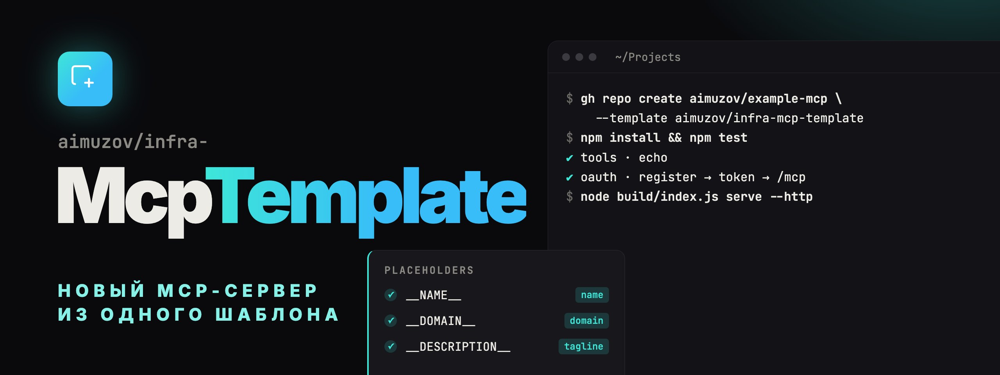

<p align="center">
	<a href="README.md"></a>
	
</p>

<p align="center">
	
</p>

<p align="center">
	<a href="https://github.com/aimuzov/infra-mcp-template/actions/workflows/check.yml"></a>
	<a href="https://github.com/aimuzov/infra-mcp-template/releases"></a>
	<a href="package.json"></a>
	<a href="https://modelcontextprotocol.io"></a>
	<a href="LICENSE"></a>
</p>

<h3 align="center">Новый MCP-сервер из одного шаблона</h3>
<p align="center">Сервер на stdio, размещённый OAuth-коннектор со страницами, проверки, релиз и деплой</p>

Отправная точка MCP-сервера aimuzov на [infra-mcp-kit](https://github.com/aimuzov/infra-mcp-kit): stdio-сервер с одним инструментом-примером, размещённый коннектор с OAuth и страницами в стиле «Сигнал», проверки, релиз и деплой. Примеры ниже создают `example-mcp`.

## Что внутри

- `src/server.ts`: сервер и его инструменты. Пример `echo` в stdio читает `API_TOKEN`, а в коннекторе — токен из формы входа.
- `src/http.ts`: коннектор: `tokenFormLogin`, OAuth в `sqliteStore`, маршрут `GET /api/status`.
- `src/frontend`: собственные страницы сервиса на layout кита. `status.astro` со Svelte-островом показывает, как это устроено.
- `astro.config.mjs`: `mcpPages()` с лендингом, входом, страницами ошибки и 404.
- `deploy/`: образ и compose для сервера проектов за общим Caddy.
- `.github/workflows`: `check` на каждый PR, `release` с публикацией в npm и деплоем, `pr-meta`, Renovate.

## Новый сервер

1. Создай репозиторий из шаблона и замени плейсхолдеры. README в замену не попадают: у нового сервера будет свой.

    ```bash
    gh repo create aimuzov/example-mcp --public --template aimuzov/infra-mcp-template --clone
    cd example-mcp
    grep -rl --exclude-dir=node_modules --exclude-dir=.git --exclude='README*' \
    	-e __NAME__ -e __DOMAIN__ -e __DESCRIPTION__ . |
    	xargs perl -pi -e 's/__NAME__/example-mcp/g; s/__DOMAIN__/example-mcp.aimuzov.online/g; s/__DESCRIPTION__/Что делает сервер, одной строкой/g'
    npm install
    ```

2. Сбрось версию и ченжлог, доставшиеся от шаблона:

    ```bash
    echo '{}' > .release-please-manifest.json
    npm pkg set version=0.0.0
    : > CHANGELOG.md
    ```

3. Замени `echo` в `src/server.ts` настоящими инструментами и поправь список в `src/server.test.ts`.
4. Реализуй `verifyToken` в `src/http.ts`: проверь токен запросом к API сервиса и верни `{ subject: <id пользователя>, claims: { apiToken: token } }`. Claims доходят до `createServer` в `auth.extra`, так инструменты получают токен. До этого коннектор отклоняет любой вход.
5. Напиши тексты страниц в `mcpPages` в `astro.config.mjs`: подзаголовок, описание, инструменты, форму входа. Страницу `/status` оставь или убери.
6. В Settings → Actions → General включи «Allow GitHub Actions to create and approve pull requests»: без этого release-please не откроет релизный PR.

Серверу только на stdio коннектор не нужен: убери `src/http.ts`, `src/http.test.ts`, `http` в `src/index.ts`, `astro.config.mjs`, `svelte.config.js`, `postcss.config.mjs`, `src/frontend`, `deploy/`, dev-зависимости Astro и site-kit и `docker` в `check.yml`.

## Запуск локально

```bash
npm start                                  # stdio, так его запускает клиент
npm run build && node build/index.js serve --http
npm run dev:pages                          # только страницы, с HMR Astro
```

`serve --http` читает окружение, см. [`.env.example`](.env.example): локально хватит `PUBLIC_URL=http://localhost:8080` и `AUTH_SECRET` от 32 символов (`openssl rand -base64 48`). Данные, включая `auth.db`, лежат в `<NAME>_DATA_DIR`, `$XDG_CONFIG_HOME/<name>` или `~/.config/<name>`. `LOG_LEVEL=debug` печатает стеки. `SENTRY_DSN` включает [отчёты об ошибках](https://github.com/aimuzov/infra-mcp-kit/blob/main/README.ru.md#sentry) в проект Sentry с именем репозитория, релиз — `__NAME__@<версия>`.

## Плейсхолдеры

- `__NAME__`: репозиторий, npm-пакет `@aimuzov/__NAME__`, бинарник, контейнер и его том, заголовок `/status`.
- `__DOMAIN__`: адрес размещённого коннектора, в `.env.example` и в деплое `release.yml`.
- `__DESCRIPTION__`: строка для `package.json` и лендинга.

## Релиз и деплой

Мёрж в `main` только обновляет релизный PR release-please. Мёрж этого PR выпускает релиз, проверки проходят ещё раз, а дальше:

- с переменной репо `NPM_PUBLISH=true` и секретом `NPM_TOKEN` релиз уходит в npm;
- с `DEPLOY_ENABLED=true` и секретом `DEPLOY_SSH_KEY` он уезжает на сервер проектов.

Ручной запуск `release` публикует тег из `tag`. Деплой тоже берёт этот тег, а если он пуст — свежий `main`.

Серверу проектов один раз нужны шаги из раздела _Adding a project_ в [infra-server](https://github.com/aimuzov/infra-server#adding-a-project): deploy key, клон в `/srv/example-mcp`, его `.env` по `.env.example`, `sites/example-mcp.caddy` с `reverse_proxy example-mcp:8080` и домен, направленный на сервер. Контейнер слушает 8080, хранит данные в томе `example-mcp-data` и подключается к сети `edge` Caddy без открытых портов.
